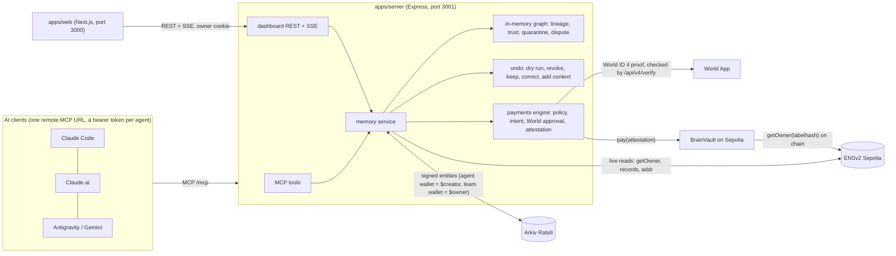

# Supabrain: project reference

**As of:** 2026-11-06 evening IST, `main` after `accb1ab`. Written by Lane B (Srijit) so that a fresh Claude session can build the UI with the full, current picture.

**If you are a Claude building the UI, read in this order:**
1. This file, all of it.
2. `CLAUDE.md` §2 (ground rules) and §6 (cross-lane contracts).
3. `docs/lanes/C-UI.md` (screens, design system, visual encodings).
4. `packages/shared/src/types.ts`. Import these types; never redefine them.

Where this file and an older doc disagree on what the server does today, this file and the code win. `CLAUDE.md` still wins on rules and ownership.

---

## 1. The product in one paragraph

**Supabrain is a shared memory for a team's AIs that remembers where every fact came from. When a fact turns out wrong, you take it back from every AI at once, and no money moves on a lie.**

- **One memory, every vendor.** Claude Code, the Claude app and Antigravity (Gemini) connect to one remote MCP server.
- **It works like git.** Every memory records:
  - its author, an ENS-named agent whose own wallet signs it on Arkiv;
  - its parents, meaning what the agent read before writing it;
  - its roots, meaning the original sources it rests on;
  - a trust level.
- **Undo.** "This is wrong" on a source first shows a dry run ("1 source · 6 memories · 3 agents · 3 vendors"), then revokes. Everything built on that source is quarantined for every AI at once, and the AIs get retraction notices. Good work stays.
- **Money.** `pay` traces where the payee address came from:
  - An address that disagrees with the vendor's own ENS record is blocked.
  - Outside content can't authorize money.
  - Risky payments need a real human through World ID.
  - Real test USDC moves through BrainVault, which checks ENS on chain.

**Positioning against memory products** (Supermemory, Notion's shared AI memory, Mem0):
- *"Supermemory helps AI remember better. Supabrain makes what AI remembers accountable."*
- *"They check what is paid. We check why the AI believes the payee, and we can make it un-believe."*
- *"Machines flag in milliseconds, humans decide in minutes. Supabrain makes the minutes in between safe (pay blocks) and reversible (one revoke)."*
- **Closing line:** *"Every AI company is racing to make AI remember more. We built the part that lets you take it back, so no money moves on a lie."*

**Story version for the pitch** (plain English, 8 pictures): https://claude.ai/artifact/Y97gb3sEWrZegkKAgfEYU5. It's private to Srijit unless shared, so this file repeats everything you need.

---

## 2. The demo story and what the UI shows at each beat

Scenario: **"the bank details changed."** The team has three agents:
- `lead-claude` (Claude, lead);
- `gem-research` (Gemini, worker, folder `research`);
- `gpt-writer` (OpenAI, worker, folder `comms`).

Vendor `acme` (Acme Studio). Team ENS name `supabrain.eth`.

| # | Beat | What happens | What drives it | What the UI must show |
|---|---|---|---|---|
| 1 | Three AIs, one memory | Each AI calls `whoami`, then reads and writes the shared memory | SSE `connected`, `memory`; `GET /api/team` | Agents rail: ENS name, vendor, role, scope, caps, a "connected via claude-code …" label |
| 2 | One fake email | Gemini stores the email as evidence (trust 1), then a memory "Acme's new wallet is 0xf892…" | SSE `memory`; `dispute` on `GET /api/graph` | A new node with source "email"; an amber **DISPUTED BY ENS** chip (ENS says 0xf15f…, the memory claims 0xf892…) |
| 3 | The lie spreads | Claude plans the payment on it; GPT drafts a thank-you note with the address | SSE `memory` with `edges` | Graph edges email → Gemini → Claude → GPT across 3 vendors |
| 4 | Pay → BLOCKED | Claude calls `pay`. ENS_MISMATCH and outside content are hard blocks | SSE `payment` (decision `blocked`, `reasons`, `path`) | A payments row BLOCKED with every reason as text, and the offending `path` highlighted in the graph |
| 5 | "This is wrong" | Owner clicks the email, sees the dry run, revokes | `POST /api/dryrun`, `POST /api/revoke`; SSE `revocation`, `notice` | The dry-run modal "1 source · N memories · N agents · N vendors · read by N", then the red cascade. The human budget memory stays green. Arkiv and vault proof links |
| 6 | AIs correct themselves | Gemini's next `recall` shows the items as QUARANTINED with a `why`, plus a retraction notice | `GET /api/recall-log` | A before/after panel of the same query, before and after the revoke |
| 7 | Human approval | Claude pays `acme.supabrain.eth` 5 USDC, over its cap of 4, so the payment goes to `pending_human`. Owner approves in World App, and it's PAID on chain. The attacker's "partner" address is denied | SSE `approval`, `payment`; `GET /api/approvals` | An approval card: World QR from `verificationUri` (owner only), `userCode`, amount, payee, reasons, countdown, Cancel. Then PAID with the Etherscan link, or DENIED with "nothing moved" |
| 8 | Off switch | Owner unregisters `gem-research` on ENS. Writes stop, and a direct vault call reverts `AgentNotRegistered` | SSE `agent` (status `unregistered`) | A red "unregistered" chip with a proof link |

**Fallbacks** (never depend on a model being fooled live):
- `pnpm demo:step <step>` runs the same steps through the same MCP tools and identities.
- `?mock=1` is a last resort and must show a visible **MOCK DATA** banner.

---

## 3. Status

### Done and proven live (2026-11-06)
**Brain (Lane A, plus the QA fixes Lane B made):**
- MCP tools `whoami`, `recall`, `remember`, `explain`, `check_notices`, `pay`, `pay_status`, used from Claude Code, Claude.ai and Antigravity.
- Arkiv persistence with a startup rebuild, lineage, trust, read-sets and the read log.
- Dry run, revoke, quarantine, notices, Keep, Correct this, Add context and the recall log.
- Pairing (`/api/pair`), the dashboard API and SSE.

**ENSv2 on Sepolia:**
- Team `supabrain.eth` with its own registry.
- 3 agents, each with its own resolver and records.
- Vendor `acme.supabrain.eth` with a vendor-owned resolver.
- The kill switch (unregister, then a revert on chain).

**Money (Lane B):**
- The `decidePayment` policy.
- World ID 4 approval bound to the intent hash.
- The EIP-712 attestation and BrainVault.
- Live runs: P1 BLOCKED, revoke, World-approved PAID, deny, cancel, an on-chain `RootRevoked` refusal and the kill switch. Links in §11.

**Upgrades from the Supermemory review** (`docs/research/supermemory-plan.md`):
1. The ENS block also fires when the attacker address appears only in a vendor-tagged memory's **text**.
2. **"Disputed by ENS"** on memories, computed on read (§5.6).
3. `arkiv/why-arkiv.md` and `arkiv/reach.md` with live counts (`pnpm arkiv:reach`).
4. **Public verifier** `pnpm verify:memory <key>`. It proves authorship using only Arkiv and ENS, without our server.

**Tests:** 416 workspace tests (vitest), 47 Foundry tests, 4 fork tests against live Sepolia.

### Not done yet
- **The UI.** `apps/web` is still the S0 shell: `app/layout.tsx` and `app/page.tsx` only. There's no Tailwind, shadcn or fixtures yet. That's your job.
- Seed the judging namespace `supabrain-mumbai26` within 2 days of judging (`pnpm demo:seed`). Memories expire after 2 days.
- `docs/DEMO_SCRIPT.md`, the video, the README structure, the address table and `AI_USAGE.md`.
- Rehearsals (3 full runs).
- A faster Sepolia RPC key. This needs a human; the public RPC is slow.

---

## 4. Architecture



| Package | Owner | What it is |
|---|---|---|
| `packages/shared` | A | zod config loader, **types** (`types.ts`), interfaces, test fakes |
| `packages/ens` | A | ENS reads through the Universal Resolver, `EnsAuthority`, labelhash helpers |
| `packages/arkiv` | A | Arkiv schemas (`sb.memory`, `sb.edge`, `sb.taint`, `sb.revocation`, `sb.notice`, `sb.payment`), batch writer, decoding |
| `packages/payments` | B | `decidePayment` policy, payments engine, World client, vault client, `pay`/`pay_status` MCP tools |
| `apps/server` | A | MCP server, memory service, graph engine, undo, dashboard API, SSE, pairing |
| `apps/web` | **C (you)** | The dashboard |
| `contracts/` | B | Foundry: `BrainVault.sol` + tests |
| `scripts/` | A/B | ENS, vault, Arkiv, demo and guard scripts |

**Data flow for one memory:**
1. The agent calls `remember`.
2. The server checks ENS authority: `getOwner(labelhash)` must be the agent's wallet, the status active, and the folder within `sb.scope`.
3. It computes parents (the cites, else the read-set), trust and roots.
4. It emits SSE `memory` at once with `pending: true`.
5. It writes one Arkiv batch: memory + edges + taint rows, created by the **agent's** wallet and handed to the **team** wallet in the same batch.
6. SSE `confirmed` carries the proof URL, or `write_failed` if the write didn't land.

---

## 5. Core concepts (with what each means for the UI)

### 5.1 Memory node (`MemoryNode`)
- **Fields:** `key` (0x…64-hex Arkiv entity key), `text`, `kind`, `folder`, `trust`, `agent` (label, or `owner` for human memories), `vendor`, `seq`, `createdAt`, `expiresAt` (ms), and `kept?`.
- **Lineage fields:** `parents[]`, `roots[]`, and optionally `subject?` (an ENS name such as `acme.supabrain.eth`), `address?`, `source?` (evidence), `ref?` (private pointer), `supersedes?`.
- **State fields:** `status`, `pending?`, `proofUrl?`, `creator?`.
- **Kinds:** `fact`, `decision`, `plan`, `address`, `evidence`, `payment`, `ref`.
- **Vendors:** `claude`, `gemini`, `openai`, `human`. Always show the vendor as a **text label** next to any colour.

### 5.2 Trust
| Value | Meaning | How it's made |
|---|---|---|
| 3 | human | Only through the owner dashboard: Add context or Correct this. `roots = [ownKey]` |
| 2 | agent | An agent memory with no parents |
| 1 | evidence | Outside content (email, web, file); `roots = [source.id]` |
- An agent memory's trust is the **minimum of its parents**, and its roots are the union of its parents' roots. An agent can never produce 3.
- Show trust as a badge with a word: **HUMAN**, **AGENT** or **EVIDENCE**.

### 5.3 Lineage
- **Parents** are the agent's explicit `cites` (each must be in its read-set), or else everything it read since its last write. Quarantined items never enter a read-set.
- **`GET /api/memory/:key`** returns:
  - `lineage: string[][]`, every path from the memory back to a root (draw these as the "why does it believe this" trail);
  - `readers: string[]`, the agents that read it (from the read log).

### 5.4 Status values
| Status | Meaning | UI |
|---|---|---|
| `active` | Normal | default |
| `quarantined` | The memory or an ancestor was revoked: a revoked source root, a revoked memory or a revoked author | **QUARANTINED** label, red; show `why` (a sentence from the server) |
| `stale` | An evidence ancestor expired | **STALE** label, amber |
| `expired` | Gone from Arkiv (2-day lease ran out) | A ghost node; **EXPIRED** label |
| `proposal`, `restored` | Reserved (stretch) | label only |

**`pending: true`:** an optimistic write not yet on Arkiv. Draw it dashed with "writing to Arkiv…". It becomes solid on `confirmed`, and is dropped on `write_failed`.

### 5.5 Quarantine is computed, never stored on the memory
- Revocations are separate Arkiv entities: `source:<id>`, `memory:<key>` or `agent:<label>`.
- A memory is quarantined if it, or any ancestor, is covered by one.
- Undo never rewrites history; the original memories stay readable on Arkiv.

### 5.6 "Disputed by ENS" (new: render this)
`GET /api/graph` nodes and `GET /api/memory/:key` may carry an extra field (not part of `MemoryNode`):
```ts
dispute?:
  | { state: "disputed"; subject: string; ensAddress: `0x${string}`; claimed: string[] } // the memory claims an address for a team vendor that differs from the vendor's live ENS addr
  | { state: "unverified"; subject: string; reason: string };                            // ENS unreadable ("ENS could not be read") or no addr record
```
- **When it applies:** only to memories with a `subject` that is a team vendor, skipping `payment` and `expired` memories. It's recomputed on every read.
- **UI:** an amber chip **DISPUTED BY ENS**. Its tooltip or drawer line reads: "acme.supabrain.eth's own ENS record says 0xf15f…, this memory claims 0xf892…".
- `unverified`: a grey chip **UNVERIFIED**, with the reason.
- **QUARANTINED wins:** when a memory is both, show only the QUARANTINED styling (you may keep the dispute line in the drawer).
- **Narrative:** machines flag in milliseconds (the dispute shows at write time); humans decide in minutes (the revoke).

### 5.7 Expiry and Keep
- Memories and evidence live **2 days** on Arkiv (`arkivExpirySec.memory = 172800`).
- **Keep** (owner) extends a memory plus its edges and taint rows, by `keep.defaultDays` (7) up to `keep.maxDays` (30).
- Keep is **refused for quarantined memories** (409 `KEEP_REFUSED`), so lies die on their own.
- Revocations last the maximum (~182 days).
- **UI:** a countdown ring or "expires in 1d 6h", a Keep pin when `kept`, and a disabled Keep with that reason on quarantined memories.
- Arkiv emits no expiry event; the server sends SSE `expired` itself.

### 5.8 Private pointers (`ref`)
- Confidential content never goes on chain. A memory can hold a `PrivateRef`: `{ kind: "github" | "notion" | "url", locator, version?, label }`.
- GitHub refs are pinned to a commit SHA.
- **UI:** a lock card, "private: open with your own access", showing the label, and a link only for `url`/`notion`.

### 5.9 Notices and the recall log
- **Notices:** after a revoke, every agent that wrote or **read** an affected memory gets a retraction notice, delivered inline on its next tool call. SSE `notice {toAgent, count}` gives the unread count; show a badge on the agent card.
- **`GET /api/recall-log?agent=&q=`** returns `[{ at, agent, query, results: [{ key, status }] }]`. Use it for the before/after panel: the same query before and after the revoke.

---

## 6. MCP tools (what the AIs see)

| Tool | What it does | Notes |
|---|---|---|
| `whoami` | Returns the agent's ENS identity, role, folder scope and pay limits, read live from ENS | Called first. The first call from a client emits SSE `connected` |
| `recall {query, folder?, limit?}` | Searches the shared memory | Quarantined items come back flagged `QUARANTINED` with a `why`, never as facts. Disputed items carry the dispute text. Unread notices ride along |
| `remember {text, kind, folder, subject?, address?, source?, ref?, cites?}` | Writes a memory | Folder must be within the agent's `sb.scope`. The reply includes the dispute text when the address disagrees with ENS |
| `explain {key}` | Returns a memory's lineage and why it is (or isn't) quarantined | |
| `check_notices` | Returns unread retraction notices | |
| `pay {payee, amount, memo, cites?}` | Asks to pay `payee` (an ENS name or 0x address) in USDC | Returns paid / blocked / pending_human with reasons as text |
| `pay_status {intentId}` | Status of a pending payment | |

Agents connect with a bearer token from `/api/pair` (§8.6). The server also registers the prompt `supabrain_rules`.

---

## 7. Payments (what the UI needs to know)

### 7.1 Decision statuses (`PayDecision.status`)
| Status | Meaning | UI |
|---|---|---|
| `paid` | Money moved through BrainVault | **PAID**, Etherscan link (`txUrl`) |
| `blocked` | A hard rule failed; no override | **BLOCKED**, every reason as text, highlight `path` in the graph |
| `pending_human` | Waiting for World approval | The approval card (§7.3) |
| `denied` / `expired` / `cancelled` | The human said no, the time ran out, or the owner cancelled | **DENIED** / **EXPIRED** / **CANCELLED**, "nothing moved" |
| `failed` | Technical failure (RPC, vault) | **FAILED** plus the error text |

### 7.2 Reason codes (`PayReason`)
Lists all reasons, hard ones first.

| Code | Hard / soft | Plain-English label for the UI |
|---|---|---|
| `ENS_MISMATCH` | hard | "The address disagrees with {ensName}'s own ENS record ({ensAddress})" |
| `QUARANTINED_LINEAGE` | hard | "This payee comes from retracted memory" |
| `PROTECTED_PAYEE` | hard | "{label} is a team-controlled address and can never be paid" |
| `AGENT_NOT_AUTHORIZED` | hard | "Agent not allowed: {detail}" (ENS owner, status or role) |
| `UNKNOWN_PAYEE` | hard when the name doesn't resolve, otherwise soft | "No trusted record for this payee" |
| `OUTSIDE_CONTENT_PAYEE` | soft (needs a human) | "This address came from outside content ({sources})" |
| `NEW_PAYEE` | soft | "First payment to this payee" |
| `OVER_CAP` | soft | "Over the per-payment cap ({amount} > {cap} USDC)" |
| `OVER_DAILY` | soft | "Over the daily limit ({spentToday} of {daily} USDC spent)" |

- `blocked.path` is the offending lineage, e.g. P1 `["0xM2", "0xM1", "0xE1"]` (cite → payee memory → evidence).
- Caps come **live from ENS records** (`sb.pay.cap`, `sb.pay.daily`), not from config. `lead-claude`'s cap is 4 USDC on purpose, so the 5 USDC invoice needs a human.

### 7.3 Human approval (World ID 4)
- **The flow:**
  1. The server opens a World ID request whose action is `supabrain-pay:<intentHash>`; the signal is the same hash.
  2. `ApprovalView.verificationUri` is the World App connector URI.
  3. The owner scans it with World App.
  4. The server verifies the proof with World's `/api/v4/verify`, accepts each proof once, re-checks every hard rule live, then signs the EIP-712 attestation (`humanApproved=true`) that BrainVault checks.
- **The approval card shows:** a **QR of `verificationUri`**, an "Open in World App" link, `userCode` as a short reference, agent, payee (`payeeEns` when present), amount, reasons, an `expiresAt` countdown and a **Cancel** button (`POST /api/approvals/:id/cancel`).
- **Security:** the URI carries the bridge key. `GET /api/approvals` returns `verificationUri: ""` unless the owner cookie is sent. Show the QR **only** on the owner-authenticated dashboard, and never log it.
- The OIDC "device code" flow was also built, but the World portal for it needs an enterprise Google account (`WORLD_DEBRIEF.md`). `userCode` and `verificationUri` keep the old field names.

### 7.4 BrainVault (on chain)
`pay` checks, in order:
1. ENS `getOwner(labelhash) == msg.sender`, so an unregistered agent reverts `AgentNotRegistered`.
2. The attestation signature, its expiry and replay.
3. The revoked roots: a payment resting on a revoked source reverts `RootRevoked`.
4. The daily ceiling.

The guardian can only tighten. The vault holds test USDC (6 decimals).

---

## 8. Dashboard API reference

**Base URL:**
- Local: `http://localhost:3001`. Set `NEXT_PUBLIC_SERVER_URL` in `apps/web/.env.local`; it's public, not secret.
- Production plan: UI on `supabrain.blackslate.me`, API on `api.supabrain.blackslate.me` (same site, so the cookie works).

**Cross-origin and auth:**
- CORS allows the origins in `config/app.json` `server.allowedOrigins` (`http://localhost:3000` and the production UI).
- Always `fetch(url, { credentials: "include" })`.
- **Owner auth:** `POST /api/admin/login {passphrase}` sets the httpOnly cookie `sb_admin` (SameSite=Lax). `GET /api/admin/me` returns `{admin: boolean}`, and `POST /api/admin/logout` clears it. Owner-only routes return 401 without it. The passphrase is `DASHBOARD_ADMIN_PASSPHRASE` in the server's `.env.local`; ask the owner, never put it in the web bundle.

**Errors:** `{ error: CODE, message }` with 400 / 401 / 404 / 409 / 502. Show `message` to the user.

### 8.1 Read (public)
| Route | Returns |
|---|---|
| `GET /healthz` | Server health, including `payments: "enabled" \| "disabled"`. Hide the payments nav when disabled |
| `GET /api/team` | `{ team: {id, displayName, ens}, agents: AgentView[], vendors: string[], counts: {memories, active, quarantined, expired, pending} }` |
| `GET /api/graph?since=<seq>` | `{ nodes: (MemoryNode & {dispute?})[], edges: Edge[], seq }`. Pass the last `seq` to get only changes |
| `GET /api/memory/:key` | `MemoryNode & { lineage: string[][]; readers: string[]; why?: string; dispute? }`. 404 if expired |
| `GET /api/recall-log?agent=&q=` | `RecallLogEntry[]` (§5.9) |
| `GET /api/payments` | `Payment[]` (each with `decision` and `lineage`) |
| `GET /api/approvals` | `ApprovalView[]`, with `verificationUri` blank unless owner |
| `GET /api/stream?since=<seq>` | SSE (§9) |
| `GET /api/pair/:code` | Public on purpose (the phone opens it from the QR): `{agent, ens, client?, token, snippets, prompt, expiresAt}`. 404 when expired |

**`/api/team` details:**
- An agent carries `authority: "live" | "unavailable"`. When ENS can't be read its `status` is `"unknown"`: show "authority unknown", never a guessed status.
- `connectedClient` is a string like `"claude-code 2.1.294"`.

**`proofUrl`:** memories loaded at startup point at the Arkiv entity page (`…/entity/<key>`); new writes point at the transaction page.

### 8.2 Owner actions (cookie `sb_admin` required)
| Route | Body | Returns |
|---|---|---|
| `POST /api/dryrun` | `{ target: {type: "source"\|"agent"\|"memory", id} }` | `DryRun {target, memories, agents, vendors, readers, pendingPayments, roots}` |
| `POST /api/revoke` | `{ target, reason? }` | `{ revocationKey, arkivUrl, affected, notified, dryRun, vaultTxUrl?, cancelled, paymentsError?, ensNote? }` |
| `POST /api/memory/human` | `{ text, kind, folder, subject?, ref? }` | The new human memory (trust 3, `pending: true` until confirmed). This is **Add context** |
| `POST /api/memory/:key/keep` | `{ days? }` | `{ expiresAt, days, txUrl, extended }`. 409 `KEEP_REFUSED` if quarantined |
| `POST /api/memory/:key/correct` | `{ text }` | `{ revocationKey, arkivUrl, newKey, affected }`. Revokes `memory:<key>` and writes a human memory with `supersedes` |
| `POST /api/approvals/:id/cancel` | (none) | 204 |
| `POST /api/pair` | `{ label, client? }` | `{ agent, ens, client?, token, snippets: Record<Client,string>, prompt, code, qrPayload, expiresAt }` |

**Notes on these routes:**
- **Revoke takes about 5 s,** because the revocation is written to Arkiv first. Show "writing to Arkiv…", then the proof links: `arkivUrl`, plus `vaultTxUrl` when present.
- A failed vault step shows a red "retry" but **doesn't undo** the revoke (`paymentsError`).
- **Revoking an agent** returns `ensNote`, which says how to pause or kill it on ENS. That needs the owner key, which isn't on the server.
- **Dry-run headline format:** "{1} source · {memories.length} memories · {agents.length} agents · {vendors.length} vendors · read by {readers.length}". Add pending payments if any.

### 8.3 Pairing (onboarding, `/connect`)
- The owner calls `POST /api/pair {label, client?}` and shows a QR of `qrPayload` (`<web>/connect?code=XXXXXXXX`). The code lasts 10 minutes; the token lasts 7 days.
- The `/connect?code=` page calls `GET /api/pair/:code` and shows the per-client snippet (`claude-code`, `claude-ai`, `antigravity`, `gemini-cli`, `chatgpt`) and the prompt to paste.
- It then shows "waiting for your AI…" until SSE `connected {agent, client}`.

---

## 9. Live updates (SSE)

- **Endpoint:** `GET /api/stream?since=<seq>`.
- **Frame format:** `id: <seq>\ndata: <JSON StreamEvent>\n\n`.
- **Reconnect:** with `since` or the `Last-Event-ID` header, and the server replays what you missed. Use `EventSource(url, { withCredentials: true })`.

| Event | Do this |
|---|---|
| `memory {node, edges}` | Add or update the node; draw it dashed if `pending` |
| `confirmed {key, proofUrl}` | Make it solid; attach the proof link |
| `write_failed {key, error}` | Remove the optimistic node; toast the error |
| `revocation {target, affected, arkivUrl?, vaultTxUrl?, ensTxUrl?}` | Run the cascade animation over `affected`. Then refetch `/api/graph`, because statuses are computed server-side |
| `notice {toAgent, count}` | Set that agent's unread badge |
| `kept {key, expiresAt}` / `expired {key}` | Update the countdown, or turn the node into a ghost |
| `connected {agent, client?}` | Mark the agent connected (the `/connect` page finishes) |
| `payment {payment}` | Upsert into the payments list |
| `approval {approval}` | Show or refresh the approval card |
| `agent {agent}` | Replace that `AgentView` (e.g. `unregistered`) |

`dispute` is **not** an SSE event. After `memory` or `revocation` events, refetch `GET /api/graph?since=` or the node to get it.

---

## 10. Running it locally

**Prerequisites:** Node 22 (`nvm use 22`) and pnpm. Install with `pnpm install` at the root.

**Commands:**
- **Server:** `pnpm --filter @supabrain/server start` runs on **:3001**. It needs the root `.env.local`; the names are in `.env.example`, the values come privately from Kai or Srijit.
- **Web:** `pnpm --filter @supabrain/web dev` runs on **:3000**.
- **Both:** `pnpm dev`.

**Namespaces** (env `SUPABRAIN_APP_NAMESPACE`; every Arkiv entity carries it as its `app` attribute):
- `supabrain-mumbai26`: **the judging demo.** Empty until it's seeded within 2 days of judging.
- `supabrain-mumbai26-dev`: Lane A's dev data.
- `supabrain-mumbai26-b`: Lane B's live money rehearsal (P1, revoke, PAID, deny, cancel). **The best data to build the UI against right now.**

**Rules while running:**
- **Only one server may write to Arkiv at a time,** because the shared wallets' nonces would collide. Before starting yours, check that nobody else's is running. Srijit's local server on :3001 (namespace `-b`) may be up; ask before starting a second one.
- **Mock mode:** build screens against fixtures in `apps/web/fixtures/`. `?mock=1` must show a visible **MOCK DATA** banner.

**Useful read-only commands:**
- `pnpm arkiv:reach`: live entity counts per signer.
- `pnpm arkiv:query`: the README query.
- `pnpm verify:memory <key> [--app <ns>]`: verify authorship using Arkiv + ENS only.
- `pnpm ens:status`.
- `pnpm vault:status`.
- `pnpm run doctor`. (Plain `pnpm doctor` is a pnpm built-in.)

---

## 11. Live deployments and proof

**ENSv2 (Sepolia):**
- Team `supabrain.eth`, team registry `0xd5bC492deE1A41873Fa382fF17017F6D5506c41c`.
- Agent and vendor resolvers are in `config/deployments/ens.sepolia.json`.
- `acme.supabrain.eth` resolves to `0xf15ff64150Aa01391B6C831DBE6e14df445dB5A5`. That's Acme's own wallet, which owns its own resolver.

**BrainVault (Sepolia):** `0x2da794b8dd00afc970b372d7cf960ecd1f190ec8`, holding test USDC. Circle USDC is `0x1c7D4B196Cb0C7B01d743Fbc6116a902379C7238`.

**Arkiv Rabdi (chain 7794095) signing wallets** (`config/deployments/arkiv.rabdi.json`):

| Signer | Wallet |
|---|---|
| team | `0x4eA717986244B28B8af633f698FdDf8308D35A56` |
| lead-claude | `0xEd4ae94521A00BE3e432173F00009AFB90641bfC` |
| gem-research | `0x6c57ACAA7116c8b539EbA60698B7b644C6b4590c` |
| gpt-writer | `0x4B35c28ad6A77A49d63c052E9c35AdC7A47E14fA` |

**Live proof** (2026-11-06, namespace `supabrain-mumbai26-b`):
- **World-approved PAID** (5 USDC, `humanApproved=true`): https://sepolia.etherscan.io/tx/0x7b983ad5aafadce22a1fdd98da09a3710be64be673f96c39602c5663de517528
- **Revocation on Arkiv:** https://rabdi.explorer.arkiv.network/tx/0x6933acedc8f959aa3cde69e9620e8bdb26e039389e05315524990b7305bd78ae
- **Vault `revokeRoot`:** https://sepolia.etherscan.io/tx/0x7083d77c6266ac8afb64021d1899eb1ac7f6dd94298fafcff8153659fd983137
- **On-chain `RootRevoked` refusal:** https://sepolia.etherscan.io/tx/0x7e589a3ce39efbf3bb0f964c6f13a1cfc3d852a29e7b0a337c9521e77a70ddd4
- **Denied (nothing moved):** https://rabdi.explorer.arkiv.network/tx/0xc272dd7fa0e51ad5ea40c64a06cb1255bc70ad7f4546c2a8dc0c8e8708a8aa39
- **Cancelled (nothing moved):** https://rabdi.explorer.arkiv.network/tx/0x926cd6ffe99f47e3efc53db12ad2debf94e39cb32864ad5d2cc46afa8eba1128
- **Kill switch, `AgentNotRegistered`:** https://sepolia.etherscan.io/tx/0x516b96da3c4df023563178a2a2f71cb6d351b48abcc945d8d09d3380d53e4579

All proof links and stage ticks are in `docs/PROGRESS.md`.

---

## 12. Repo map (the files you'll touch or read)

```
apps/web/                     ← YOU: Next.js App Router (bare shell today; transpilePackages has @supabrain/shared)
packages/shared/src/types.ts  ← the contract: MemoryNode, Edge, DryRun, AgentView, PayDecision, ApprovalView, Payment, StreamEvent, Client
packages/shared/src/config.ts ← zod config loader (server-side; the web app gets values from the API, not by hard-coding)
apps/server/src/api/routes.ts ← every dashboard route (read it when in doubt)
apps/server/src/api/pair.ts   ← pairing routes
apps/server/src/engine/conflict.ts ← "Disputed by ENS" rules
apps/server/src/mcp/server.ts ← MCP tools and their text output
packages/payments/src/policy.ts    ← payment rules and reason codes
config/app.json               ← agents, trust levels, expiry, keep limits, server/web URLs
config/deployments/*.json     ← generated addresses (ENS, vault, Arkiv wallets)
docs/lanes/C-UI.md            ← screens, design system, encodings (your brief)
docs/DEMO_SCRIPT.md           ← yours to write
docs/PROGRESS.md              ← log your steps under "Log: Lane C"; cross-lane asks under "Requests"
SPONSORS.md, SECURITY.md, WORLD_DEBRIEF.md, arkiv/*.md ← sponsor evidence (read for copy, don't edit)
```

---

## 13. Rules for the UI work

1. **Edit only your lane:** `apps/web`, `docs/DEMO_SCRIPT.md`, the README structure and visuals, and the video. If you need a server change, write it under **Requests** in `docs/PROGRESS.md` (`- [ ] C → A: …`) instead of editing `apps/server`.
2. **Import the types** from `@supabrain/shared`. Never redefine them.
3. **Nothing hard-coded:**
   - Team name, agents, caps, ENS names and addresses come from `/api/team` and the API.
   - Explorer links come from the API (`proofUrl`, `txUrl`, `arkivUrl`).
   - The server URL comes from `NEXT_PUBLIC_SERVER_URL`.
   - `pnpm lint:hardcode` must pass (fixtures are exempt).
4. **No secrets in the browser.** `NEXT_PUBLIC_*` is public. Never put the admin passphrase, tokens or the Arkiv key in the bundle. Run `pnpm check:secrets` before every push (it also greps `apps/web/.next`).
5. **Every status has a text label,** never colour alone: QUARANTINED, DISPUTED BY ENS, UNVERIFIED, STALE, EXPIRED, PENDING, BLOCKED, PAID, DENIED, CANCELLED, AUTHORITY UNKNOWN.
6. **Fail closed in the UI too.** If ENS authority is unknown, say so; never show a guessed "active".
7. **Real, not simulated.** Fixtures only in `?mock=1`, with the MOCK DATA banner.
8. **Git:** small conventional commits (`feat(web): …`), `git pull --rebase` before pushing, **never force-push**. Work on `main` inside `apps/web`.
9. **After each step,** log it under "Log: Lane C" in `docs/PROGRESS.md` (`/log` format in CLAUDE.md §3.4).

---

## 14. Open requests addressed to the UI (from `docs/PROGRESS.md`)

- [ ] Render the **"Disputed by ENS"** chip (§5.6), amber with a text label; QUARANTINED wins.
- [ ] Add to `DEMO_SCRIPT.md`: *"Gemini saves the email and is told at once it disagrees with Acme's ENS (machines flag in milliseconds); the AIs build on it anyway; pay is BLOCKED; one revoke cleans it (humans decide in minutes)."*
- [ ] Put `pnpm verify:memory <key>` in the README as the "verify without trusting us" command, next to `pnpm arkiv:query`.
- [ ] Payments: list **all** reasons, hard first; highlight `blocked.path` in the graph.
- [ ] Approval card: QR of `verificationUri` (owner only), an "Open in World App" link, `userCode`, a countdown and Cancel.
- [ ] Switch screens from fixtures to the real API, screen by screen (§8). Every endpoint above is live.

**Suggested build order** (matches C-UI.md):
1. `/t` graph and drawer on real data.
2. The agents rail.
3. The dry-run modal and revoke cascade.
4. Payments and the approval card.
5. `/connect`.
6. Before/after.
7. Rules page and landing.

---

## 15. Honest limits (use this wording in the UI and README)

- **Custodial agent keys.** The server holds the agent, team, policy and guardian keys for the demo. The owner key, the vault ceilings and the ENS kill switch aren't on the server, and the guardian can only tighten.
- **Lineage is recorded by the server.** `pnpm verify:memory` proves each signer owns its agent's ENS name **now** and that the team holds each record. It can't prove ownership at write time.
- **We flag; we don't "detect lies".** Disputed means the address disagrees with the vendor's ENS record. Humans decide what's wrong.
- **Who may approve.** Any verified human who scans the QR can approve, which is why the QR shows only on the owner dashboard.
- **Testnet only,** with synthetic data. World proofs are real (production World App).
